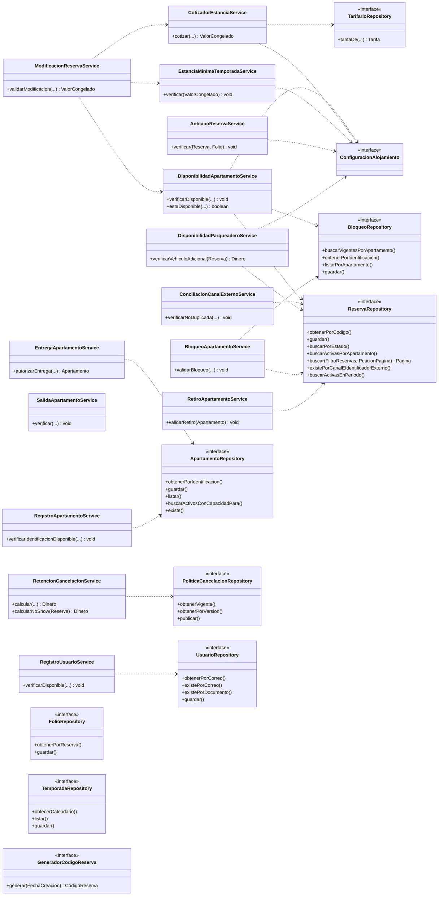

# Diagrama de clases — SGA · Entrega 2

Actualiza el diagrama de la Entrega 1 con los cambios del dominio: `Temporada`, `CalendarioTemporadas` y `TipoTemporada`; tarifas dentro de `Apartamento`; `IdentificadorExterno`, mascotas y vehículos en `Reserva`; `Usuario`, `CorreoElectronico` y `Rol`; `MedioPago`; `CapacidadParqueadero`; los servicios del catálogo que faltaban y los nuevos puertos.

Convenciones: composición `*--`, dependencia o referencia por identificador `..>`, implementación `..|>`. Se abrevian parámetros con `...`.

## Entidades, agregados y objetos de valor

```mermaid
classDiagram
direction TB
  class Reserva {
    <<aggregate_root>>
    -CodigoReserva codigo
    -IdentificacionApartamento apartamento
    -CanalOrigen canalOrigen
    -IdentificadorExterno identificadorExterno
    -FechaCreacion fechaCreacion
    -Ocupante titular
    -VersionPolitica politica
    -Estancia estancia
    -List~Ocupante~ ocupantes
    -ValorCongelado valor
    -EstadoReserva estado
    -List~EventoReserva~ historial
    -LocalTime horaEstimadaLlegada
    -String novedadLlegada
    -int mascotas
    -List~Vehiculo~ vehiculos
    +crear(...)$ Reserva
    +reconstruir(...)$ Reserva
    +indicarHoraEstimadaLlegada(...) void
    +indicarMascotas(...) void
    +registrarVehiculo(...) void
    +siguienteVehiculoEsAdicional(int) boolean
    +confirmar(...) void
    +cancelar(...) void
    +registrarLlegada(...) void
    +registrarSalida(...) void
    +informarNovedadLlegada(...) void
    +resolverNovedadLlegada(...) void
    +declararNoShow(...) void
    +vencer(...) void
    +estaVencida(...) boolean
    +modificarEstancia(...) Dinero
    +perteneceA(DocumentoIdentidad) boolean
    +totalOcupantes() int
  }
  class Ocupante {
    <<entity>>
    -DocumentoIdentidad documento
    -LocalDate fechaNacimiento
    -String nombre
    +reconstruir(...)$ Ocupante
    +edadA(LocalDate) int
    +esFacturableEn(Estancia, UmbralEdadFacturable) boolean
    +actualizarNombre(String) void
  }
  class Apartamento {
    <<aggregate_root>>
    -IdentificacionApartamento identificacion
    -String nombre
    -int dormitorios
    -Capacidad capacidad
    -EstadoOperativo estadoOperativo
    -boolean activo
    -List~Tarifa~ tarifas
    +reconstruir(...)$ Apartamento
    +admite(int) boolean
    +puedeRecibirGrupo() boolean
    +tieneTarifasCompletas() boolean
    +actualizarTarifa(TipoTemporada, Dinero) void
    +tarifaPara(TipoTemporada) Tarifa
    +marcarOcupado() void
    +liberar() void
    +iniciarPreparacion() void
    +marcarPreparado() void
    +declararFueraDeServicio() void
    +reincorporarAPreparacion() void
    +cambiarCapacidad(Capacidad) void
    +desactivar() void
    +reactivar() void
  }
  class Folio {
    <<aggregate_root>>
    -CodigoReserva reserva
    -List~Cargo~ cargos
    -List~Pago~ pagos
    -boolean cerrado
    -boolean alojamientoLiquidado
    -String autorizacionCierre
    +reconstruir(...)$ Folio
    +registrarCargo(Cargo) void
    +registrarPago(Pago) void
    +verificarLiquidacion(...) void
    +liquidarAlojamiento(...) void
    +saldo() Dinero
    +totalPagado() Dinero
    +cerrar(String) void
  }
  class Pago {
    <<entity>>
    -UUID identificacion
    -Dinero valor
    -MedioPago medio
    -LocalDateTime momento
    -String concepto
    -String autor
  }
  class Bloqueo {
    <<aggregate_root>>
    -UUID identificacion
    -IdentificacionApartamento apartamento
    -Estancia periodo
    -String motivo
    -boolean vigente
    -String motivoLevantamiento
    +reconstruir(...)$ Bloqueo
    +afecta(Estancia) boolean
    +levantar(String) void
  }
  class PoliticaCancelacion {
    <<aggregate_root>>
    -VersionPolitica version
    -List~TramoCancelacion~ tramos
    -BigDecimal porcentajeNoShow
    -LocalTime horaEntrada
    +retencionPorCancelacion(...) Dinero
    +retencionPorNoShow(Dinero) Dinero
    +siguienteVersion(...) PoliticaCancelacion
  }
  class Usuario {
    <<aggregate_root>>
    -UUID identificacion
    -CorreoElectronico correo
    -DocumentoIdentidad documento
    -String nombreCompleto
    -Rol rol
    -String contrasenaCifrada
    -boolean activo
    +registrarHuesped(...)$ Usuario
    +reconstruir(...)$ Usuario
    +puedeIniciarSesion() boolean
    +desactivar() void
  }
  class CalendarioTemporadas {
    <<value_object>>
    -List~Temporada~ temporadas
    +tipoDe(LocalDate) TipoTemporada
    +con(Temporada) CalendarioTemporadas
  }
  class Temporada {
    <<value_object>>
    -String nombre
    -TipoTemporada tipo
    -LocalDate fechaInicio
    -LocalDate fechaFin
    +incluye(LocalDate) boolean
    +seSolapaCon(Temporada) boolean
  }
  class Tarifa {
    <<value_object>>
    -IdentificacionApartamento apartamento
    -TipoTemporada temporada
    -Dinero valorPorOcupanteNoche
  }
  class ValorCongelado {
    <<value_object>>
    -List~CargoNoche~ detalle
    -BigDecimal porcentajeDescuento
    +subtotal() Dinero
    +total() Dinero
    +descuento() Dinero
  }
  class CargoNoche {
    <<value_object>>
    -LocalDate noche
    -TipoTemporada temporada
    -Dinero tarifaPorOcupante
    -int ocupantesFacturables
  }
  class Estancia {
    <<value_object>>
    -LocalDate fechaEntrada
    -LocalDate fechaSalida
    +noches() int
    +seSolapaCon(Estancia) boolean
  }
  class Cargo {
    <<value_object>>
    -TipoCargo tipo
    -String concepto
    -Dinero valor
    -LocalDateTime momento
    -String autor
  }
  class EventoReserva {
    <<value_object>>
  }
  class Vehiculo {
    <<value_object>>
    -String placa
  }
  class IdentificadorExterno {
    <<value_object>>
    -String valor
  }
  class CorreoElectronico {
    <<value_object>>
    -String valor
  }
  class CapacidadParqueadero {
    <<value_object>>
    -int cupos
    +admite(int) boolean
  }
  class TipoTemporada {
    <<enumeration>>
    BASE
    ALTA
    ESPECIAL
  }
  class MedioPago {
    <<enumeration>>
    EFECTIVO
    TARJETA_DEBITO
    TARJETA_CREDITO
    TRANSFERENCIA_BANCARIA
  }
  class Rol {
    <<enumeration>>
    ADMINISTRADOR
    RECEPCIONISTA
    HUESPED
  }
  class CanalOrigen {
    <<enumeration>>
    PORTAL
    DIRECTO
    EXTERNO
    +loRegistra(Rol) boolean
  }
  class EstadoReserva {
    <<enumeration>>
    PENDIENTE
    CONFIRMADA
    EN_CURSO
    FINALIZADA
    CANCELADA
    NO_SHOW
  }
  class EstadoOperativo {
    <<enumeration>>
    PREPARADO
    OCUPADO
    PENDIENTE_PREPARACION
    EN_PREPARACION
    FUERA_DE_SERVICIO
  }
Reserva *-- Ocupante : ocupantes
Reserva *-- Estancia
Reserva *-- ValorCongelado
Reserva *-- EventoReserva : historial
Reserva *-- Vehiculo : vehiculos
Reserva *-- IdentificadorExterno
Reserva *-- CanalOrigen
Reserva *-- EstadoReserva
ValorCongelado *-- CargoNoche
CargoNoche *-- TipoTemporada
Apartamento *-- Tarifa : tarifas
Apartamento *-- EstadoOperativo
Tarifa *-- TipoTemporada
Folio *-- Cargo
Folio *-- Pago
Pago *-- MedioPago
Bloqueo *-- Estancia : periodo
CalendarioTemporadas *-- Temporada
Temporada *-- TipoTemporada
Usuario *-- CorreoElectronico
Usuario *-- Rol
Reserva ..> Apartamento : IdentificacionApartamento
Reserva ..> PoliticaCancelacion : VersionPolitica
Folio ..> Reserva : CodigoReserva
Bloqueo ..> Apartamento : IdentificacionApartamento
Reserva ..> Usuario : propietario por documento del titular
```

## Servicios de dominio y puertos

## Adaptadores de infraestructura

| Puerto | Adaptador que usa la aplicación | Adaptador en memoria (solo pruebas) |
|---|---|---|
| `ReservaRepository` | `ReservaJpaRepository` | `ReservaRepositoryEnMemoria` |
| `ApartamentoRepository` | `ApartamentoJpaRepository` | `ApartamentoRepositoryEnMemoria` |
| `FolioRepository` | `FolioJpaRepository` | `FolioRepositoryEnMemoria` |
| `BloqueoRepository` | `BloqueoJpaRepository` | `BloqueoRepositoryEnMemoria` |
| `PoliticaCancelacionRepository` | `PoliticaCancelacionJpaRepository` | `PoliticaCancelacionRepositoryEnMemoria` |
| `TemporadaRepository` | `TemporadaJpaRepository` | `TemporadaRepositoryEnMemoria` |
| `UsuarioRepository` | `UsuarioJpaRepository` | `UsuarioRepositoryEnMemoria` |
| `GeneradorCodigoReserva` | `GeneradorCodigoReservaJpa` | `GeneradorCodigoReservaEnMemoria` |
| `TarifarioRepository` | `TarifarioRepositoryAdapter` (temporada por `CalendarioTemporadas`, tarifa por `Apartamento`) | lambda en las pruebas |
| `ConfiguracionAlojamiento` | `ParametrosAlojamiento` creado desde `PropiedadesAlojamiento` | `ParametrosDePrueba` |
| `CifradorContrasenas` (aplicación) | `CifradorContrasenasBCrypt` | mock |
| `EmisorTokens` (aplicación) | `EmisorTokensJwt` | mock |
