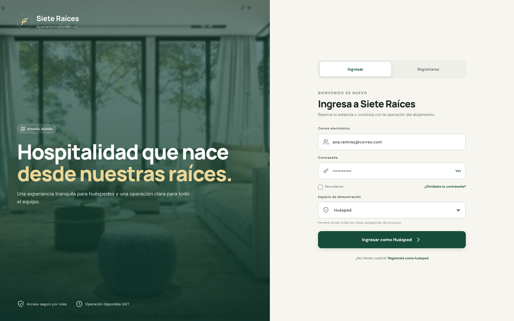
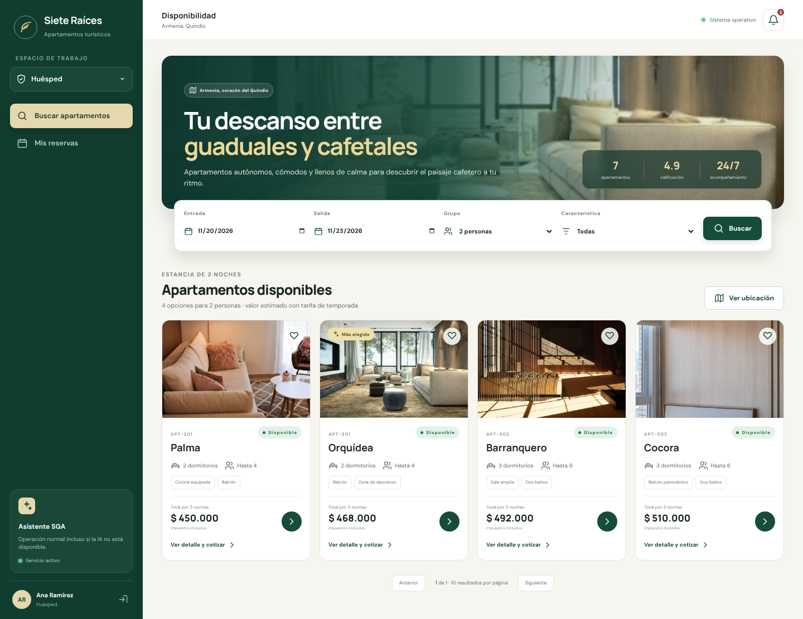
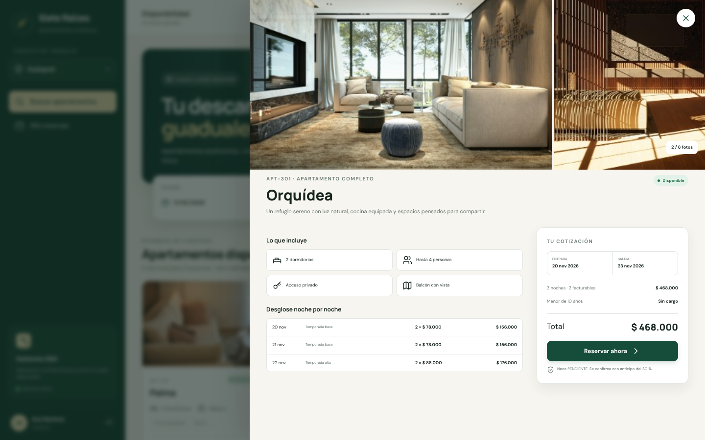
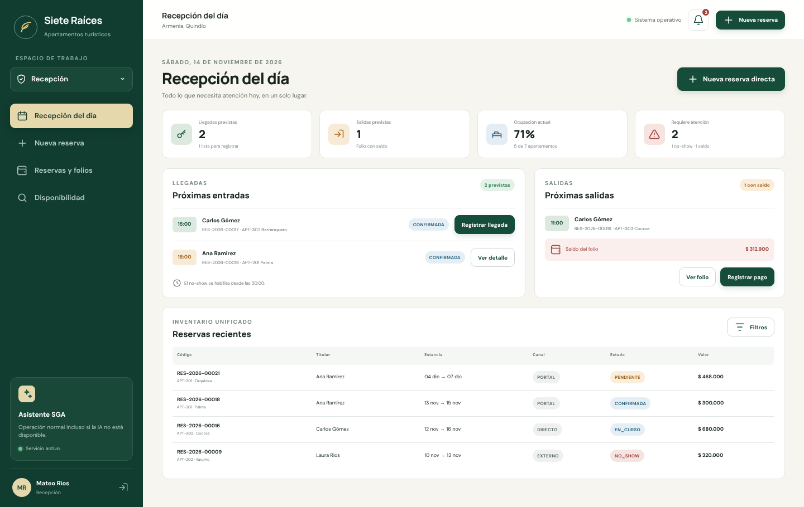

# Mockups del SGA

Antes de implementar el frontend diseñamos las pantallas en Figma, por rol y con la identidad visual de Siete Raíces. Los datos de ejemplo son los del proyecto: apartamentos de la Ficha, reservas, folios y estados del dominio.

- Diseño editable: [Mockups SGA – Siete Raíces](https://www.figma.com/design/qcg3J7Mi0UETTfTzDlfyhg) (todas las pantallas en un lienzo, agrupadas por rol).
- Prototipo navegable: [Figma Make](https://www.figma.com/make/qDKNMVkXlNyy2tCnUQEqa3/Ordenar-y-completar-el-SGA).
- `pantallas/`: imagen de cada pantalla a 1440 px de ancho.

## Pantallas

| Rol | Pantallas |
|---|---|
| Acceso | [01 Login](pantallas/01-login.png) · [02 Registro de huésped](pantallas/02-registro.png) |
| Huésped | [03 Buscar apartamentos](pantallas/03-buscar-apartamentos.png) · [04 Detalle y cotización](pantallas/04-detalle-apartamento.png) · [05 Mis reservas](pantallas/05-mis-reservas.png) |
| Recepción | [06 Recepción del día](pantallas/06-recepcion-del-dia.png) · [07 Nueva reserva (canal directo)](pantallas/07-nueva-reserva.png) · [08 Reservas y folios](pantallas/08-reservas-y-folios.png) |
| Personal de servicio | [09 Preparación de apartamentos](pantallas/09-preparacion.png) |
| Administrador | [10 Apartamentos](pantallas/10-admin-apartamentos.png) · [11 Temporadas y tarifas](pantallas/11-admin-temporadas.png) · [12 Política de cancelación](pantallas/12-admin-politica.png) · [13 Bloqueos](pantallas/13-admin-bloqueos.png) · [14 Usuarios](pantallas/14-admin-usuarios.png) · [15 Reportes](pantallas/15-reportes.png) |

